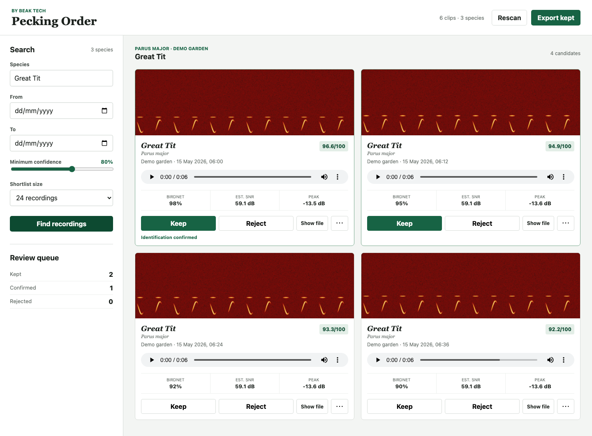

# Pecking Order

**Put your station's recordings in order, best first.**

Pecking Order is a local review tool by Beak Tech for people running **BirdNET-Go or BirdNET-Pi**. Find promising recordings, listen to them, keep your favourites and prepare a folder for manual submission to Xeno-canto.

It **never changes original recordings or uploads to Xeno-canto**. BirdNET identifications are suggestions: you must listen and confirm each identification before exporting. Source databases are opened read-only.



*The screenshot uses synthetic demonstration audio and metadata, not recordings from a real station.*

## Install

**Pre-release:** this package has not been published to npm yet. Use the source checkout or local-package preview below for now. The `npx pecking-order` examples describe the intended published release.

You need **Node.js 22.13 or newer**, npm, and **FFmpeg plus FFprobe** on PATH. There are no npm runtime dependencies. Check `node --version`, `ffmpeg -version` and `ffprobe -version` in the terminal you will use.

| System | Audio tools |
| --- | --- |
| macOS | With Homebrew installed: `brew install ffmpeg` |
| Debian/Ubuntu, including Ubuntu in WSL | `sudo apt install ffmpeg` |
| Other Linux distributions | Install FFmpeg using your distribution's package manager |
| Windows | Choose a build from [FFmpeg downloads](https://ffmpeg.org/download.html), add the `bin` folder containing `ffmpeg.exe` and `ffprobe.exe` to PATH, then open a new terminal |

Pecking Order checks both tools at startup and explains what to install if either cannot run. Native Windows supports BirdNET-Go. BirdNET-Pi filenames contain colons: on Windows, follow the [WSL import instructions](docs/birdnet-pi-windows.md) and keep the copied archive in Linux storage.

Make a dedicated review folder. Your config, reviews, measurements and exports stay here, independently of npm's package cache:

```bash
mkdir pecking-order-review
cd pecking-order-review
```

Run the appropriate quick start below from this folder. Later, run `npx pecking-order` from the **same folder** to reopen it. Stop the server with Ctrl+C.

### Run a source checkout now

From the checkout, `npm start -- --help` runs the app without installing dependencies. To use a separate review folder, run `node /path/to/pecking-order/src/cli.js` there, followed by the same options shown below. The checkout's directory can have any name.

To preview the actual package without publishing, run `npm pack --ignore-scripts` in the checkout, then from your review folder:

```bash
npx --offline --yes --package /absolute/path/to/pecking-order-0.1.0.tgz pecking-order --help
```

Replace `--help` with the source options below. Keep using that local-package command until publication. npm's [package execution documentation](https://docs.npmjs.com/cli/v11/commands/npm-exec/) explains the `--package` option.

## BirdNET-Go quick start

Point `--archive` at the configured audio export folder containing the year/month folders. Set the time zone used by the station's recording process or container:

```bash
npx pecking-order --source birdnet-go --archive "/path/to/clips" --source-timezone Europe/London
```

Use `UTC` if that process runs in UTC. The inspected BirdNET-Go source writes process-local time with a literal `Z` in filenames; **do not assume that `Z` proves UTC**. Its logging time zone does not establish the recording clock either.

Supported filenames include `parus_major_72p_20260515T120000Z.wav` and `parus_major_72p_20260515T120000Z_15s.wav`, with WAV, FLAC, MP3, M4A, Opus or Ogg extensions.

The audio folder is sufficient. For common names, Pecking Order optionally reads `birdnet.db` beside that folder; use `--database PATH` for another location. Legacy `notes` records and combined names stored in v2 `labels` are understood. Scientific-only metadata falls back to scientific names. An explicit `labelsPath` in your config can supply or override names; no BirdNET label files are bundled.

## BirdNET-Pi quick start

Point `--archive` at the extracted-recordings directory, usually `BirdSongs/Extracted`, or its `By_Date` directory. Supply the matching station's SQLite database, normally **`BirdNET-Pi/scripts/birds.db`**:

```bash
npx pecking-order --source birdnet-pi --archive "/path/to/BirdSongs/Extracted" --database "/path/to/BirdNET-Pi/scripts/birds.db" --source-timezone Europe/London
```

Use the **Pi's recording time zone**, even when reviewing on another computer. Keep the original `By_Date/<date>/<common-name folder>/<filename>` layout. Exact filenames in the database provide scientific names, common names, confidence and times; names are never guessed from audio filenames.

For a copied archive, use a consistent SQLite backup from the same station. Copying just a live database file while it is being written may omit committed data in its journal. The [Windows/WSL guide](docs/birdnet-pi-windows.md) includes a read-only backup example that also works when preparing a copy for macOS or Linux.

**Missing older audio is normal:** BirdNET-Pi deletes old recordings but keeps their database records. Import reports explain this and show a count with at most three examples per issue. Database rows are read one at a time with `.iterate()`, so the whole detection history is not loaded into memory. Indexing still requires memory for available recordings.

### SQLite and Node version

BirdNET-Pi uses built-in `node:sqlite`, opened **read-only**. This decision raised the minimum Node version from 20.19 to **22.13**; it adds no SQLite npm dependency or external SQLite executable. There is **no `BirdDB.txt` fallback**.

A missing, unreadable or incompatible database stops the import and names the expected file, including before a cached Pi index is used. Node 22's specific SQLite `ExperimentalWarning` is suppressed; other warnings and errors remain visible.

## Compatibility

Compatibility is checked against these **source revisions**, using synthetic fixtures derived from their formats. This is not a claim that every release or live installation has been tested.

| Source | Revision inspected | Coverage |
| --- | --- | --- |
| [BirdNET-Go](https://github.com/tphakala/birdnet-go) | [`91618b861`](https://github.com/tphakala/birdnet-go/commit/91618b8617f5de5fe89968f9d62ab92591f836dd) | Year/month clips, duration suffixes, six audio extensions; optional legacy/v2 common-name metadata |
| [Nachtzuster BirdNET-Pi](https://github.com/Nachtzuster/BirdNET-Pi) — primary Pi target | [`88985a3`](https://github.com/Nachtzuster/BirdNET-Pi/commit/88985a3a6fb1931a33f26ba1c46717a2a444c5b7) | `By_Date` layout, SQLite detections, standard and RTSP filenames |
| [Original BirdNET-Pi](https://github.com/mcguirepr89/BirdNET-Pi) | [`a2febea`](https://github.com/mcguirepr89/BirdNET-Pi/commit/a2febea9c278836b7c130b36cf5e5058a0f32248) | Original filenames and apostrophe-free stored common names |

Local tests and installed-package checks pass on macOS with Node 22.13.0 and 24.22.1. GitHub Actions is configured to run tests and offline package checks on macOS, Windows and Linux with the minimum Node version, latest 22 and 24. Hosted jobs have not yet run because the public repository has not been created. Windows/Linux desktop launchers are covered by simulated tests; a real WSL transfer is still unverified. BirdNET Analyzer segments and multiple stations in one workspace are outside the initial release.

## Review and export

1. Choose a species, dates, confidence threshold and shortlist size.
2. Listen to the recordings and inspect their spectrograms.
3. **Keep** or **Reject** each recording. Open **⋯** on a kept recording to edit its details.
4. Check species, location, coordinates, recording equipment and other submission details. Confirm the identification manually.
5. Choose **Export kept**. Every selected recording must be confirmed before export succeeds.

The app opens at `http://127.0.0.1:4317` and is available only on this computer. Use `--port NUMBER` to change the port or `--no-open` to open the printed URL yourself. **Show file** requests Finder's file selection on macOS or the containing folder on Windows/Linux, and always offers a copyable path. Headless systems work with the printed URL and path fallback.

Exports go into a new `exports/xeno-canto-*/` folder with WAV files, `xeno-canto-metadata.csv` and a Pecking Order checklist. The CSV is a preparation manifest, not an upload format or an automated submission. It includes original source paths for your reference. Review what you share and choose a recording licence when uploading to Xeno-canto yourself.

WAV export applies no analysis filter or further lossy compression. Converting a lossy source to WAV cannot restore lost detail. Files are named with species, date, time and a recording ID; failed exports remove temporary output and preserve previous exports.

### What the quality score means

The score out of 100 helps order a shortlist; it does not verify a species or measure scientific recording quality. It combines:

- **55 points:** BirdNET confidence, scaled from 0–100%.
- **25 points:** estimated signal-to-noise ratio, scaled between 3 and 28 dB.
- **15 points:** peak level, scaled between −55 and −6 dB.
- **5 points:** a measured peak with no clipping risk (peak at or below −0.5 dB).

Audio measurements use a 300 Hz–12 kHz analysis pass. Estimated SNR is the difference between RMS peak and estimated noise floor; other sounds can score well too. The analysis filter changes neither originals nor exports. Unavailable measurements add no points; failed analysis is retried on the next search. **Your ears make the final decision.**

## Configuration and saved work

On first launch, `config/station.local.json` is created **inside the folder where you started Pecking Order**. It saves supplied paths, the confirmed recording time zone and discovered coordinates. Existing files are never rewritten: later command-line overrides last for that run only. Edit the JSON to make changes permanent.

If the recording time zone is missing, the available setup information is saved and an error explains how to confirm `sourceTimezone`. Pecking Order never guesses it from this computer's display time zone. The `timezone` field controls display, date filters and exports, and defaults to this computer's zone. Ambiguous or nonexistent local times around daylight-saving changes are reported and excluded.

Use `--config PATH` for another JSON config. This changes which settings file is read; **data and exports still belong to the current working folder**. Separate review folders keep stations' settings and reviews separate. Paths in a config resolve beside that file; CLI and environment paths resolve from the working folder.

Archive path precedence is `--archive PATH`, then `PECKING_ORDER_ARCHIVE`, then the config's `archiveRoot`. Other overrides are:

| CLI option | Config field |
| --- | --- |
| `--source birdnet-go\|birdnet-pi` | `source` |
| `--database PATH` | `databasePath` |
| `--source-timezone ZONE` | `sourceTimezone` |
| `--station-config PATH` | `stationConfigPath` |

Quote paths with spaces. Windows CLI paths can use backslashes (`--archive "D:\Bird recordings\clips"`). In JSON use forward slashes (`"archiveRoot": "D:/Bird recordings/clips"`) or doubled backslashes. A network share can use `"archiveRoot": "//station/share/clips"` if accessible to the user running Pecking Order.

### Station details

Fill in `country` and the `station` fields for location, coordinates, elevation, recorder and microphone before exporting. Country defaults to empty. You can import coordinates from a native station config with `--station-config /path/to/config.yaml` for Go or `--station-config /etc/birdnet/birdnet.conf` for Pi.

Without an explicit native config, discovery checks only beside the archive and in its parent; Go also checks the parent's `config/config.yaml`. It never searches unrelated home or system settings. Only literal `birdnet.latitude`/`birdnet.longitude` in ordinary Go YAML, or Pi `LATITUDE`/`LONGITUDE` assignments, are read. Shell commands, variables and advanced YAML are not executed; enter coordinates manually for those forms. Existing nonempty values, including zero, take precedence. Verify imported coordinates before exporting.

### Files to keep

- `config/station.local.json`: your settings.
- `data/state.json`: saved reviews and measured quality scores.
- `data/library-index.json` and `data/spectrograms/`: reusable caches.
- `exports/`: completed submission folders.

Back up your config and `data/state.json`. Return to the same review folder on later launches. Use **Rescan** after changing the archive or its metadata. Failed rescans preserve the previous index. Source type, archive path, required Pi database path and source time zone distinguish recording IDs; moving those inputs does not automatically migrate reviews. Optional names and labels can change without losing reviews.

These files belong to your review folder, never the installed package or npm cache. The source checkout ignores data, exports, `config/*.local.*`, common audio/database files and local environment settings. Custom filenames outside those patterns need their own ignore rules. The npm package includes only application files, neutral examples and public documentation.

## Development

Run `npm test` in the source checkout. `npm run test:package` packs and installs the app offline in temporary directories, checks package contents and runs both source workflows from the installed package (Go only on native Windows). Tests use temporary fixtures and generated audio, never real station recordings or databases. The runtime uses Node's standard library and has no npm dependencies.

## Credits and licence

Pecking Order is by **Beak Tech**. Copyright **Beak Tech Community Interest Company**; its own code is released under the [MIT licence](LICENSE).

- [BirdNET](https://birdnet.cornell.edu/), from the Cornell Lab of Ornithology and Chemnitz University of Technology, provides the identification technology used by the recording systems.
- [BirdNET-Go](https://github.com/tphakala/birdnet-go), by tphakala and contributors, and [BirdNET-Pi](https://github.com/Nachtzuster/BirdNET-Pi), including the [original project](https://github.com/mcguirepr89/BirdNET-Pi), provide the station recordings and metadata.
- [Xeno-canto](https://xeno-canto.org/) is the recording-sharing community for which the export workflow helps you prepare submissions.
- [FFmpeg](https://ffmpeg.org/) supplies the locally installed audio tools.

These projects, their models, label files and contributed recordings have their own licences. No BirdNET implementation, models or label assets are bundled, and the MIT licence does not relicense your recordings or grant recording-upload rights.
